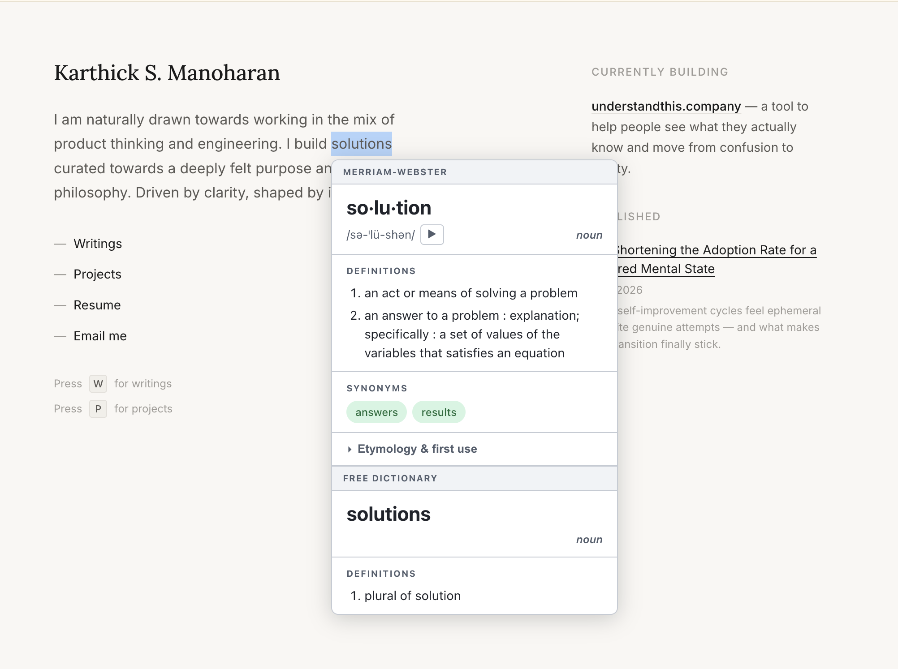
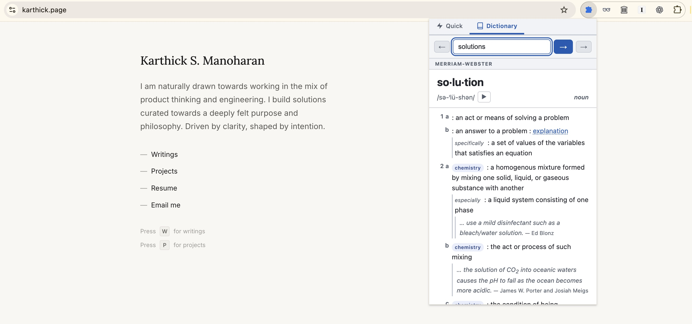

# Merriam-Webster Quick Lookup

Look up words while reading in Chrome. Select a word for a quick definition, or open the extension's toolbar popup for a full dictionary entry.

Use Merriam-Webster, Free Dictionary, or both. This is an independent project and is not affiliated with or endorsed by Merriam-Webster.

## Features

- Definitions beside the word you select, with an optional double-click-only trigger.
- Quick lookup with short definitions, synonyms, antonyms, and Merriam-Webster pronunciation audio when available.
- Full Dictionary view with detailed senses, examples, related-word navigation, and back/forward history within the popup.
- Separately labeled results from both providers in one popup.
- System, light, and dark appearance, plus navigation dock placement at the top, bottom, left, or right.

Available details depend on the provider and entry.

## Screenshots

### Double-click lookup

Select a word on a page to see quick results from the enabled providers. Enable double-click-only mode in Options if you prefer that trigger.



### Full definition view

Open the toolbar popup and choose **Dictionary** to read detailed entries and follow related words.



## Install from source

You need Chrome, Node.js 22 or newer, and npm 8 or newer. Node includes npm. The build uses Vite, React, and TypeScript.

1. Clone this repository, or download its source ZIP and extract it.
2. Open a terminal in the project folder and run:

   ```sh
   npm ci
   npm run build
   ```

3. Open `chrome://extensions` in Chrome and enable **Developer mode**.
4. Click **Load unpacked** and select the generated **`dist/`** folder.
5. Pin **Merriam-Webster Quick Lookup** from Chrome's extensions menu if you want easy toolbar access.
6. Configure a lookup source below, then refresh any already-open web pages.

Keep the `dist/` folder in place while using the unpacked extension. It is generated locally and is excluded from version control.

## Configure lookup sources

Right-click the extension icon and choose **Options**. You can also open its **Details** page under `chrome://extensions` and choose **Extension options**. Click **Save** after changing settings.

### Merriam-Webster

Merriam-Webster is selected by default. Obtain your own keys through the [Merriam-Webster API registration page](https://dictionaryapi.com/register/index): one for the **Collegiate Dictionary** and one for the **Thesaurus**.

Paste them into **Dictionary API Key** and **Thesaurus API Key**, leave **Merriam-Webster** selected under **Lookup Sources**, and save.

| Lookup mode | Required Merriam-Webster keys |
| --- | --- |
| Page selection popup and toolbar Quick mode | Dictionary and Thesaurus |
| Toolbar Dictionary mode | Dictionary |

Keys belong in the Options page; no `.env` file or source edit is needed. Do not commit keys or include them in issue reports.

### Free Dictionary

To use the extension without API keys:

1. Select **Free Dictionary** under **Lookup Sources**.
2. Uncheck **Merriam-Webster** if you do not have its keys configured.
3. Leave the language code as `en` for English, or enter a language code supported by the provider.
4. Click **Save**.

The extension sends these lookups to `freedictionaryapi.com`. You can enable both providers to see separately labeled results. Keep at least one selected: clearing both falls back to Merriam-Webster.

## Usage and preferences

- **On a page:** select a single word of at least two characters with the mouse. The popup appears near the selection; click outside it to dismiss it. Under **Selection Popup Trigger**, enable **Show popup on double-click only** to require a double-click. Ordinary selection is the default.
- **From the toolbar:** click the extension icon, type a word, and press Enter. Choose **Quick** for a short overview or **Dictionary** for the full entry. Dictionary mode supports back/forward navigation and clickable Merriam-Webster cross-references and spelling suggestions when supplied.
- **Pronunciation:** click the play button when Merriam-Webster audio is available.
- **Appearance:** choose **System**, **Light**, or **Dark** in Options. System follows your device's appearance.
- **Navigation Dock Position:** choose where the Quick/Dictionary controls sit in the toolbar popup.

Save preferences, then reopen the toolbar popup to pick up source or dock changes.

## Privacy and permissions

Lookups require an internet connection. Selected or typed words are sent to the providers you enable. Merriam-Webster requests include the relevant API key in the request URL; pronunciation playback requests audio from `media.merriam-webster.com`. Free Dictionary requests include the chosen language code. The lookup code sends the requested word rather than the full page contents.

Preferences and API keys are stored in `chrome.storage.sync` and may sync through Chrome when sync is enabled. The extension has no project-operated backend or analytics code. Dictionary content comes from the selected providers.

| Manifest access | Purpose in this project |
| --- | --- |
| `storage` | Save and read API keys and preferences. |
| `offscreen` | Play pronunciation audio in an offscreen document. |
| `activeTab` | Declared by the manifest; the current selection popup uses the content script described below. |
| Content script matching `<all_urls>` | Listen for word selections and display definitions on eligible pages. This is broad page access, subject to Chrome's restrictions and your extension site-access settings. |

## Troubleshooting

| Problem | What to check |
| --- | --- |
| API keys are not configured | Save the appropriate Merriam-Webster keys, or select only Free Dictionary. Quick lookup needs both Merriam-Webster keys. |
| No selection popup | Refresh the page after installing or reloading the extension. Select one word of at least two characters, check the trigger setting, and check Chrome's site-access settings. |
| Popup unavailable on a page | Try an ordinary HTTPS web page. Chrome internal pages and other protected pages restrict content scripts. |
| No results or an API error | Check spelling, provider selection, the Free Dictionary language code, network access, and API credentials. Provider coverage and availability vary. |
| Changes do not appear | Save Options, reopen the toolbar popup, and refresh the page. For source changes, rebuild and reload the extension as described below. |
| Extension will not load | Select `dist/`, not the source folder, and confirm `npm run build` finished successfully. |

When reporting a problem, include the Chrome version, selected provider, reproduction steps, and error message. Remove keys and personal information from logs and screenshots.

## Development

```sh
npm ci             # Install the locked dependency versions
npm test           # Run theme and UI verification scripts
npm run build      # Build the unpacked extension into dist/
npm run dev        # Rebuild when source files change
```

Watch mode writes build output; after a rebuild, click **Reload** on the extension at `chrome://extensions`, then refresh the page where you are testing. The verification scripts exercise local behavior with fixtures and browser API mocks; they do not verify live provider access or replace a Chrome smoke test.

| Path | Contents |
| --- | --- |
| `src/content/` | Page selection and definition popup |
| `src/popup/` | Toolbar Quick and Dictionary views |
| `src/options/` | API keys and preferences |
| `src/background/`, `src/offscreen/` | Lookup requests and audio playback |
| `src/components/`, `src/utils/`, `src/theme/` | Shared UI, provider parsing, and themes |
| `public/icons/` | Extension icons |
| `scripts/` | Local verification scripts |
| `docs/images/` | README screenshots |

The build and tests use the public source files only. Local planning, agent tooling, editor metadata, environment files, dependencies, logs, and generated builds are excluded by `.gitignore`. These rules apply when adding files through Git; they do not filter manual uploads or remove files already tracked. Review the files being staged before publishing.

## License and attribution

No project license has been chosen or included yet. This repository does not currently provide a project license grant.

Merriam-Webster and Free Dictionary supply the dictionary content. Their names and content are credited to their respective providers; this project does not claim ownership of that content.
